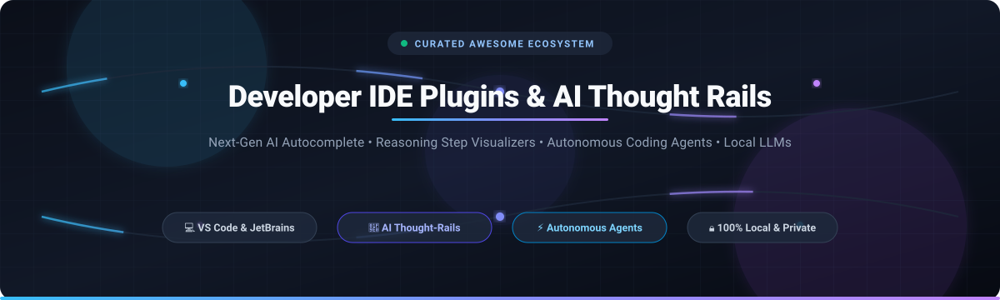

<p align="center">
  
</p>

# 🚀 Awesome Developer IDE Plugins & AI Thought Rails

<p align="center">
  <a href="https://github.com/ishandutta2007/Awesome-Developer-IDE-Plugins-AI-Thought-Rails/stargazers"></a>
  <a href="https://github.com/ishandutta2007/Awesome-Developer-IDE-Plugins-AI-Thought-Rails/network/members"></a>
  <a href="https://github.com/sindresorhus/awesome"></a>
  <a href="https://github.com/ishandutta2007/Awesome-Developer-IDE-Plugins-AI-Thought-Rails/blob/main/LICENSE"></a>
</p>

> 🌟 **A definitive, curated directory of cutting-edge AI Developer IDE Plugins, Thought-Rail Reasoning Trackers, Autonomous Coding Agents, and Local LLM Autocomplete Engines.**  
> Supporting **VS Code**, **JetBrains IDEs** (IntelliJ IDEA, PyCharm, WebStorm, Rider, GoLand, CLion), **Neovim/Vim**, **Emacs**, and **Zed**.

---

## 📑 Table of Contents

- [📊 Sector Overview & Market Dynamics](#-sector-overview--market-dynamics)
- [🏢 SaaS & Hosted Commercial Platforms](#-saas--hosted-commercial-platforms)
- [🔓 Open-Source GitHub Projects](#-open-source-github-projects)
- [🛠️ Architectural Cheat Sheet: Building AI Thought Rails](#️-architectural-cheat-sheet-building-ai-thought-rails)
- [🤝 How to Contribute](#-how-to-contribute)
- [💖 Support & Share](#-support--share)
- [⚖️ Disclaimer & Security Guidance](#️-disclaimer--security-guidance)

---

## 📊 Sector Overview & Market Dynamics

The global AI developer tools and AI-assisted software engineering market is estimated at **$7.5B in 2025** and is projected to surpass **$30B by 2032**, compounding at an aggressive ~26% CAGR. 

Market dynamics demonstrate a **moderately fragmented, dual-tier structure**:
- **Big Tech & Foundation Hubs**: Trillion-dollar cloud hyperscalers (Microsoft GitHub Copilot, Amazon Q Developer) and core IDE vendors (JetBrains AI) anchor corporate enterprise spend with bundled security, enterprise governance, and ecosystem lock-in.
- **Fast-Moving AI-Native Innovators & Open Protocols**: High-velocity startups (Cursor / Anysphere, Codeium Windsurf, Augment Code, Tabnine) and community open-source protocols (Cline, Continue, OpenHands, Aider, Tabby, Avante.nvim, MCP) capture developer mindshare through frontier reasoning chains ("thought rails"), transparent diff review loops, multi-agent orchestration, and local zero-data-retention execution. The market is decidedly **not winner-take-all**, as developer preferences split across custom local fine-tunes, sovereign on-prem LLM privacy, and bleeding-edge agent autonomy.

---

## 🏢 SaaS & Hosted Commercial Platforms

Below is the curated breakdown of premier commercial AI coding platforms and IDE plugins, ranked by corporate scale (valuation / market capitalization in descending order):

| Company / Product | Company Size (Valuation / Revenue) | Starting Pricing Tier | Free Tier Limits / Free Trial | Primary IDE & Environment Support | Key Differentiators |
| :--- | :--- | :--- | :--- | :--- | :--- |
| **[Microsoft / GitHub Copilot](https://github.com/features/copilot)** | ~$3.1T Market Cap *(Microsoft)* / $1.2B+ ARR Copilot run-rate | **$10 / user / month** *(Copilot Individual)* | **Free Plan**: 2,000 code completions/month & 50 chat messages/month *(Free for verified students & open-source maintainers; 30-day free trial on Pro)* | VS Code, Visual Studio, JetBrains, Xcode, Neovim | Ubiquitous IDE integration, Copilot Chat, multi-model selection (Claude 3.5 Sonnet, GPT-4o, Gemini 1.5 Pro), and Copilot Edits agent. |
| **[Amazon Q Developer](https://aws.amazon.com/q/developer/)** | ~$2.2T Market Cap *(Amazon)* / Multi-billion AWS segment | **$19 / user / month** *(Amazon Q Developer Pro)* | **Free Tier Forever**: Unlimited basic code suggestions, up to 50 agentic code-gen tasks/month, & 5 security scans/user/month | VS Code, JetBrains IDEs, Visual Studio, AWS Cloud9, Terminal | Deep AWS console & CLI integration, automated multi-file feature dev, automated Java language version upgrades, inline vulnerability remediation. |
| **[JetBrains AI Assistant & Junie](https://www.jetbrains.com/ai/)** | ~$7.5B Est. Valuation / ~$500M+ Annual Revenue | **$10 / user / month** *(or $100 / year)* | **7-Day Free Trial**: Full access to cloud LLM completions, interactive chat, and refactoring actions | IntelliJ IDEA, PyCharm, WebStorm, Rider, CLion, GoLand, Android Studio | Deep native AST parsing, project dependency graph context, Junie autonomous coding agent, integrated commit message generation. |
| **[Cursor (Anysphere)](https://www.cursor.com)** | ~$2.5B Valuation *(Series A/B)* | **$20 / user / month** *(Pro Plan)* | **Hobby Plan (Free Forever)**: 2-week Pro trial, then 2,000 completions + 50 slow premium requests/month + 200 cursor-small requests | AI-Native Fork of VS Code (macOS, Windows, Linux) | Composer multi-file unified refactoring, ultra-fast custom Tab autocomplete, background indexing, agent terminal loops. |
| **[Windsurf (Codeium)](https://codeium.com/windsurf)** | ~$1.25B Valuation *(Series C Unicorn)* | **$15 / user / month** *(Pro Plan)* | **Free Plan Forever**: Unlimited autocomplete, 100 fast Cascade agentic prompts/month, unlimited slow prompts | Windsurf Native IDE + Plugins for VS Code, JetBrains, Vim/Neovim, Emacs, Xcode | Cascade Flow collaborative AI pairing, real-time command execution, dynamic context pinning, multi-file code editing. |
| **[Sourcegraph Cody](https://sourcegraph.com/cody)** | ~$750M Valuation *(Venture Backed)* | **$9 / user / month** *(Pro Tier)* | **Free Plan Forever**: 200 chat & command queries/month and unlimited autocompletions | VS Code, JetBrains IDEs, Neovim, Web UI | Deep multi-repo context indexing via Sourcegraph Enterprise Code Graph, multi-model switcher (Anthropic, OpenAI, Google). |
| **[Augment Code](https://www.augmentcode.com)** | ~$977M Valuation *(Series B)* | **$25 / user / month** *(or $20/mo billed annually)* | **Free Trial Only**: 14-day full-access trial with 1,000+ contextual completions & multi-file codebase queries | VS Code, JetBrains IDEs | Industrial codebase comprehension, split-second cross-file reasoning, deep type and dependency relationship tracking. |
| **[Tabnine](https://www.tabnine.com)** | ~$300M Valuation / Series B | **$12 / user / month** *(Pro Plan)* | **Starter Plan (Free Forever)**: Basic short inline code completions up to 2-3 words; 90-day Pro trial for teams | VS Code, IntelliJ, PyCharm, Android Studio, WebStorm, Rider, Eclipse | Strict zero-data-retention, trained strictly on permissively licensed code, air-gapped VPC on-prem enterprise deployment options. |
| **[Pieces for Developers](https://pieces.app)** | ~$50M Valuation / Series A | **$10 / user / month** *(Pro Plan)* | **Free Forever Plan**: Local micro-LLM offline engine, unlimited personal snippet captures, & contextual search | VS Code, JetBrains, Visual Studio, Obsidian, Chrome, Desktop App | Cross-app workflow context capture, temporal developer memory, local offline on-device processing, multi-editor synchronization. |
| **[Supermaven](https://supermaven.com)** | Acquired by Cursor / Scale-up | **$10 / user / month** *(Pro Tier, or $100/yr)* | **Free Tier Forever**: Fast inline code completion with standard context window length | VS Code, JetBrains IDEs, Neovim | Babble architecture delivering 1-million-token context window with sub-50ms latency for near-instantaneous completions. |

---

## 🔓 Open-Source GitHub Projects

Explore the most prominent open-source AI IDE plugins, thought-rail visualizers, and autonomous coding extensions. 

Sorted in descending order by **GitHub Star Count**:

| Repository / Project | Stars | Focus & Description | Supported IDEs / Tools |
| :--- | :--- | :--- | :--- |
| **[sst/opencode](https://github.com/anomalyco/opencode)** | [](https://github.com/anomalyco/opencode/stargazers) | Terminal-first autonomous AI coding agent designed to operate fluidly with Neovim, Helix, and tmux terminal IDEs. | Terminal, Neovim, Helix, Zed |
| **[zed-industries/zed](https://github.com/zed-industries/zed)** | [](https://github.com/zed-industries/zed/stargazers) | High-performance Rust-built code editor featuring native inline AI assistants, multi-model routing, and Assistant Panel thought streams. | Zed (macOS, Linux) |
| **[All-Hands-AI/OpenHands](https://github.com/OpenHands/OpenHands)** | [](https://github.com/OpenHands/OpenHands/stargazers) | Autonomous AI software engineer capable of modifying codebases, executing terminal commands, browsing web docs, and pushing git diffs. | Standalone IDE, Web, Docker, VS Code |
| **[modelcontextprotocol/servers](https://github.com/modelcontextprotocol/servers)** | [](https://github.com/modelcontextprotocol/servers/stargazers) | Reference open-source Model Context Protocol (MCP) servers connecting IDE extensions directly to Git, databases, filesystems, and developer tools. | Continue, Cline, Roo Code, Claude, Zed |
| **[cline/cline](https://github.com/cline/cline)** | [](https://github.com/cline/cline/stargazers) | Autonomous coding agent extension for VS Code with transparent step-by-step reasoning thought-rails, human-in-the-loop diff approvals, and browser testing. | VS Code, Cursor, Windsurf |
| **[block/goose](https://github.com/aaif-goose/goose)** | [](https://github.com/aaif-goose/goose/stargazers) | Extensible open-source AI agent developed by Block that executes shell scripts, coordinates tool plugins, and pairs with IDE coding sessions. | CLI, Neovim, VS Code |
| **[Aider-AI/aider](https://github.com/Aider-AI/aider)** | [](https://github.com/Aider-AI/aider/stargazers) | Gold-standard command-line AI pair-programming tool pairing with any IDE via `--watch-files` mode to apply git-committed multi-file edits. | Any IDE (VS Code, JetBrains, Neovim, Emacs) |
| **[continuedev/continue](https://github.com/continuedev/continue)** | [](https://github.com/continuedev/continue/stargazers) | The leading open-source AI code assistant extension for VS Code and JetBrains; supports custom slash commands, MCP tools, and local Ollama/vLLM models. | VS Code, JetBrains (IntelliJ, PyCharm, etc.) |
| **[TabbyML/tabby](https://github.com/TabbyML/tabby)** | [](https://github.com/TabbyML/tabby/stargazers) | Self-hosted AI coding assistant written in Rust with local GPU inference, repo context retrieval, and lightweight plugins for multiple editors. | VS Code, JetBrains, Vim/Neovim |
| **[voideditor/void](https://github.com/voideditor/void)** | [](https://github.com/voideditor/void/stargazers) | Open-source alternative to Cursor built as a VS Code fork; provides direct local LLM routing, checkpointed agent edits, and transparent thought inspection. | Open-Source IDE (VS Code Fork) |
| **[RooCodeInc/Roo-Code](https://github.com/RooCodeInc/Roo-Code)** | [](https://github.com/RooCodeInc/Roo-Code/stargazers) | Advanced agentic VS Code extension (Cline fork) with specialized persona modes (Architect, Code, Debug, Orchestrator) and prompt thought-rails. | VS Code |
| **[yetone/avante.nvim](https://github.com/yetone/avante.nvim)** | [](https://github.com/yetone/avante.nvim/stargazers) | High-performance Neovim plugin bringing Cursor-like AI pairing, inline diff previews, and reasoning visualizers directly to Lua/Neovim setups. | Neovim (>= 0.10) |
| **[JetBrains/thinkrail](https://github.com/JetBrains/thinkrail)** | [](https://github.com/JetBrains/thinkrail/stargazers) | Open-source JetBrains plugin and research framework for structuring, visualizing, and constraining AI multi-step reasoning rails inside IntelliJ IDEs. | JetBrains IDEs |
| **[sweepai/sweep](https://github.com/sweepai/sweep)** | [](https://github.com/sweepai/sweep/stargazers) | Open-source AI junior developer that turns GitHub issues into tested pull requests, generating clear thought steps and code diffs. | GitHub Actions, VS Code, Web |
| **[olimorris/codecompanion.nvim](https://github.com/olimorris/codecompanion.nvim)** | [](https://github.com/olimorris/codecompanion.nvim/stargazers) | Extensible Neovim AI client offering slash commands, inline buffer transformations, tool execution, and transparent prompt chain inspection. | Neovim |
| **[twinnydotdev/twinny](https://github.com/twinnydotdev/twinny)** | [](https://github.com/twinnydotdev/twinny/stargazers) | 100% private, zero-telemetry local AI code completion extension for VS Code powered by Ollama, LM Studio, and llama.cpp. | VS Code |
| **[karthink/gptel](https://github.com/karthink/gptel)** | [](https://github.com/karthink/gptel/stargazers) | Fast, modular LLM client for Emacs supporting dynamic buffer context, tool calling, and local LLM backends. | GNU Emacs |
| **[smallcloudai/refact](https://github.com/smallcloudai/refact)** | [](https://github.com/smallcloudai/refact/stargazers) | Self-hosted AI coding assistant and IDE extension with integrated fine-tuning, codebase RAG, and autonomous refactoring capabilities. | VS Code, JetBrains |
| **[ggml-org/llama.vim](https://github.com/ggml-org/llama.vim)** | [](https://github.com/ggml-org/llama.vim/stargazers) | Official, ultra-lightweight Vim/Neovim plugin providing Fill-in-the-Middle (FIM) code completions directly via local `llama.cpp` server. | Vim, Neovim |
| **[supermaven-inc/supermaven-nvim](https://github.com/supermaven-inc/supermaven-nvim)** | [](https://github.com/supermaven-inc/supermaven-nvim/stargazers) | Official open-source Neovim integration for Supermaven's ultra-fast 1-million-token context completion engine. | Neovim |

---

## 🛠️ Architectural Cheat Sheet: Building AI Thought Rails

```
   ┌───────────────────────────────────────────────────────────────┐
   │                  DEVELOPER IDE ENVIRONMENT                    │
   │      (VS Code / JetBrains / Neovim / Zed / Emacs)             │
   └──────────────┬───────────────────────────────▲────────────────┘
                  │                               │
       AST & File │ Real-Time        Inline Diffs │ Thought-Rail
       Context    │ Telemetry         & Streaming │ Feedback
                  ▼                               │
   ┌──────────────────────────────────────────────┴────────────────┐
   │             AI THOUGHT-RAIL ORCHESTRATION ENGINE              │
   │  • Step Decomposition (Plan -> Check -> Execute -> Verify)    │
   │  • Model Context Protocol (MCP) Tool Calls                    │
   │  • AST Syntax Tree Validation & Guardrails                    │
   └──────────────┬───────────────────────────────▲────────────────┘
                  │                               │
         Prompt & │ Reasoning            Tool Data│ Embeddings
         RAG Docs │ Queries           & Responses │ & Weights
                  ▼                               │
   ┌──────────────────────────────────────────────┴────────────────┐
   │                  INFERENCE PROVIDERS & RUNTIMES               │
   │   ☁️ Cloud: Anthropic Claude, OpenAI, Google Gemini, Bedrock   │
   │   🔒 Local: Ollama, vLLM, llama.cpp, TabbyML, Refact Engine   │
   └───────────────────────────────────────────────────────────────┘
```

- **🧠 Step-by-Step Thought Rails**: Use **JetBrains/thinkrail**, **Cline**, or **Roo Code** to constrain the LLM into explicit chain-of-thought plans before editing code.
- **⚡ High-Speed Autocomplete**: Combine **Supermaven** or local **llama.vim** / **Tabby** for sub-50ms keystroke completion.
- **🛡️ Air-Gapped & Local Privacy**: Run **Continue** or **Twinny** connected to local **Ollama** or **vLLM** with zero external network telemetry.
- **🔌 Extensible Tool Ecosystem**: Wire in **Model Context Protocol (MCP)** servers to allow your IDE agent to interact safely with Git repositories, terminals, linters, and SQLite databases.

---

## 🤝 How to Contribute

We welcome contributions from developers, researchers, and open-source maintainers! 💡

1. 🍴 **Fork the repository** on GitHub.
2. 🌿 **Create a new branch** (`git checkout -b feature/add-new-plugin`).
3. 📝 **Add or update entries** in `README.md`:
   - Keep SaaS entries with explicit starting tier prices and exact free tier / trial terms.
   - For open-source repos, place them in the table sorted by star counts with the badge format:  
     `[](https://github.com/<owner>/<repo>/stargazers)`
4. 🧪 **Check markdown formatting** and verify all external hyperlinks.
5. 🚀 **Submit a Pull Request** with a concise summary of changes.

---

## 💖 Support & Share

If this curated guide helps elevate your IDE setup or developer productivity:

- ⭐ **Star this repository** to help fellow developers discover it!
- 📢 **Share with your team & network** on X/Twitter, LinkedIn, and developer Discords.
- ☕ **Sponsor open-source work** via [GitHub Sponsors](https://github.com/sponsors/ishandutta2007).

---

## ⚖️ Disclaimer & Security Guidance

- ⚠️ **Community Resource**: This repository is maintained as an independent community-curated list for informational purposes.
- 🛡️ **Autonomous Agent Safety**: IDE extensions equipped with autonomous shell execution or MCP tool access (e.g., Cline, Roo Code, OpenHands) can edit file trees and run CLI commands. Always inspect diffs and keep approval confirmation prompts enabled.
- 🔐 **Data Privacy**: Never transmit proprietary keys, production credentials, or sensitive codebases to third-party cloud LLMs without verifying zero-data-retention and enterprise confidentiality policies. For sensitive enterprise code, utilize local self-hosted engines (*Ollama, Tabby, Refact*).

---

<p align="center">
  <sub>Crafted with ❤️ for software engineers, IDE plugin authors, and AI DevEx pioneers worldwide.</sub>
</p>
